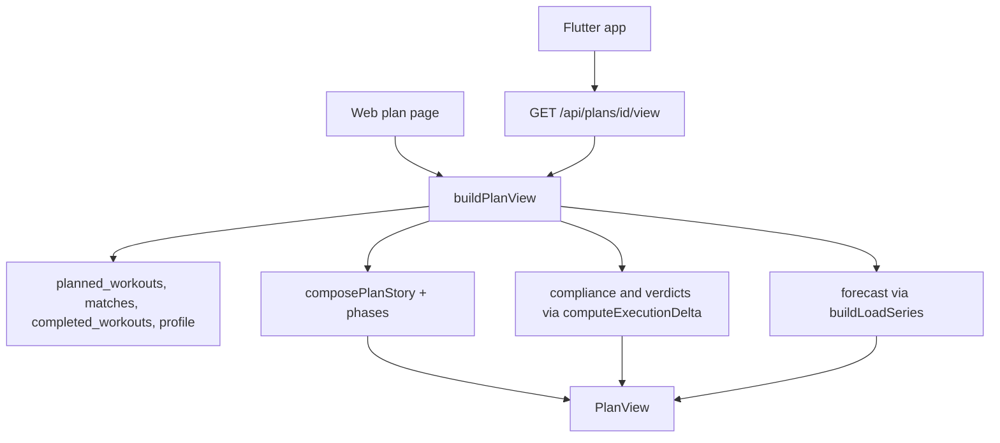

# Plan Tab Story, Results and Forecast - Plan

## Goal Capsule

- **Objective:** Make the Plan tab on web and mobile explain the plan in words, show whether the athlete is following it, and project where the block ends.
- **Product authority:** Ryan (owner). Scope confirmed in dialogue on 2026-10-16; origin is idea 1 of `docs/ideation/2026-10-15-mcp-connector-and-web-plan-tab-ideation.html`.
- **Open blockers:** None. Deferred questions are listed under Outstanding Questions.

## Product Contract

### Summary

The Plan tab on web and mobile opens with a plain-language story of the plan (goal, how the block is shaped, why) and a week-by-week outline beneath it. Sessions show planned vs. executed with a verdict, and a form forecast runs to the end of the block. Our code composes the story and outline from the plan's workouts, with no model call, so every plan gets them.

### Problem Frame

The web Plan tab was rebuilt on 2026-10-14 to show derived content (week progress, volume bars, sport mix, next session). The athlete still opens it looking for a description of the plan, finds none, and closes the tab. The generator writes a plan-level narrative, but plans have no field to keep it, and coach-assigned and imported plans never had one. Per-session rationale and planned load are stored but never shown on the tab, and nothing on the tab says whether the athlete is doing the plan. Mobile keeps its own copy of the summary logic, so the two tabs drift.

### Key Decisions

- **The story is derived from the workouts, not model-written or stored.** It works for every plan source, costs no tokens against the 8k budget, and cannot contradict the workouts it describes. The trade-off is plainer prose than a model would write.
- **Web and mobile ship together.** The new story, outline, results and forecast are derived in one place both clients read, so they cannot drift; the existing summary cards keep their local logic until a follow-up retires it.
- **The forecast is end-of-block form, not race-day form.** Generated blocks are about four weeks, so they rarely reach the event date. The forecast reaches the event date only when the plan does.
- **Results reuse the existing deterministic execution comparison and tolerances.** The verdict on the Plan tab must agree with the verdict in workout reports.

### Requirements

**Plan story**

- R1. The Plan tab opens with a short plain-language story: the plan's goal, how the block is shaped (build, recovery, taper), and why it is shaped that way.
- R2. The story is composed from the plan's workouts and event details without a model call, and every active plan shows one regardless of source (AI, coach-assigned, imported).
- R3. When the data does not support a claim (no event, no rationale, no phase), the story omits that claim rather than inventing it.

**Week-by-week outline**

- R4. Under the story, each week of the plan has a readable line: its focus, rough volume, and key sessions.
- R5. The outline marks the current week and shows past weeks' planned vs. executed volume, counting only sessions due to date so skipped or moved sessions do not distort compliance.

**Session detail**

- R6. Each session in the outline shows its stored rationale and intensity target when it has them, and a planned-load figure when known.
- R7. A session the athlete has completed shows a verdict chip (as prescribed, under, over, or the report's partial-data wording) from the same logic reports use.

**Forecast**

- R8. The tab projects fitness, fatigue and form to the end of the plan block from completed history plus remaining planned load, with the existing form verdict wording.
- R9. The forecast is labeled as end-of-block unless the plan reaches the event date, in which case it also shows form on event day.
- R10. When too many remaining sessions have neither a planned load nor a duration for an honest projection, the tab states that the forecast is unavailable instead of showing a misleading figure.

**Both clients**

- R11. Web and mobile Plan tabs show the same story, outline, results and forecast for the same plan, computed from one shared source.
- R12. Every new element has loading, error and empty states. A plan with no completed sessions yet shows the story and outline without results.

### Acceptance Examples

- AE1. **Covers R2, R3.** Given an imported plan with no rationale and no event date, when the athlete opens the Plan tab, the story describes the block's shape and volume and says nothing about an event or reasons.
- AE2. **Covers R5.** Given week 2 had five scheduled sessions, one of them skipped and two moved to next week, when the athlete views week 2, compliance counts only the two still scheduled there, and the skipped session shows as a count.
- AE3. **Covers R7.** Given a planned 45 minute run matched to a completed 38 minute run, when the athlete views that session, the chip shows the same verdict the workout report gives.
- AE4. **Covers R9.** Given a four-week plan whose event date is ten weeks out, the forecast reads as end-of-block form and shows no event-day figure.
- AE5. **Covers R10.** Given most remaining sessions have neither a planned load nor a duration, the forecast area says the projection is unavailable.

### Scope Boundaries

- Plan generation changes (candidate preview, actionable failure messages, realtime status) are out; they are idea 7 of the ideation.
- All MCP connector work (proposals, provenance audit, write gate, connected-assistants panel) is out; those are ideas 2 to 6.
- A model-written narrative, whether saved at generation or generated on demand, is out of scope.
- Editing the plan from the tab is out.

### Dependencies / Assumptions

- The plans table has no narrative field, and the generator's optional plan-level `narrative` is not persisted (checked by search of `supabase/migrations/` and `apps/web/src/`). This scope does not depend on that changing.
- Sessions store `rationale` and `planned_load` columns (`supabase/migrations/0007_plans_and_planned_workouts.sql`), but production values for `structure` and `planned_load` are sparse and have drifted. R3 and R10 exist for that reason.
- The execution comparison (`apps/web/src/ai/reports/delta.ts`), load series (`apps/web/src/training-load/load-series.ts`) and form verdict (`apps/web/src/training-overview/calc.ts`) already exist and are deterministic.
- Athlete dates resolve in the athlete's stored timezone, per the matching learning.

### Outstanding Questions

#### Deferred to Planning

- How phases (build, recovery, taper) are recognized for plans whose workouts carry no phase.
- How verdicts are fetched for a whole plan without per-workout report queries.
- How the shared source reaches the Flutter app, given it authenticates with bearer tokens only (see Bearer-token routes in `AGENTS.md`).
- How much of the story and outline copy is templated vs. conditional on available data.
- Whether a persisted plan-level field becomes worthwhile later; revisit only if derived stories read too thin.

### Sources

- `docs/ideation/2026-10-15-mcp-connector-and-web-plan-tab-ideation.html`
- `docs/solutions/screens-show-content-not-row-metadata.md`
- `apps/web/app/(athlete)/plan/page.tsx`, `apps/web/src/plan/plan-summary.ts`, `apps/web/src/plan/PlanOverview.tsx`
- `packages/shared/src/plan-generation.ts`

---

## Planning Contract

**Product Contract preservation:** changed, clarifications only, after document review: Key Decisions (web and mobile now scoped to the new sections), R7 (partial-data chip wording), R10 and AE5 (unavailable means neither load nor duration), AE2 (moved sessions count in the week they were moved to). Scope is unchanged.

### Key Technical Decisions

- KTD1. **One server-side read model, `buildPlanView`, feeds both clients.** The web page calls it directly in the server component. Flutter calls a new `GET /api/plans/[id]/view` that wraps it. The result is validated by a hand-authored Zod `PlanViewSchema` in `packages/shared`, with a hand-ported Dart model (no codegen across the TS/Dart boundary, per `AGENTS.md`). Satisfies R11.
- KTD2. **The route authenticates with `resolveAuth` and reads data with the admin client plus explicit `athlete_id` filters.** Mobile sends bearer only, and `createClient()` would run PostgREST as `anon` for it (see Bearer-token routes in `AGENTS.md`). Same pattern as `apps/web/app/api/plans/[id]/route.ts` and `apps/web/src/ai/reports/context.ts`. Every admin query carries the `service-role: explicit user filter required` comment.
- KTD3. **Phases are derived from the weekly volume shape, not from a stored label.** A stored `structure.phase` is used only when every workout of the plan carries one. Otherwise: the last 1 to 2 weeks before `event_date` that drop below the prior peak week are taper; a non-final week at or below a fixed fraction of the prior week is recovery; the remaining weeks are build, with the highest-volume week named peak. Thresholds are named constants in one file, tuned like the delta tolerances.
- KTD4. **Counted sessions are `planned`, `moved` and `completed` rows at their stored `scheduled_date`; `skipped` rows are excluded and shown as a count.** A move updates the same row in place (`status='moved'` plus the new date, in `apps/web/app/api/workouts/[id]/status/route.ts`), so a moved row is the live session in its new week. `planned` and `moved` rows both count as remaining work until completed.
- KTD5. **Verdicts come from two batched queries and the unchanged `computeExecutionDelta`.** One read for the plan's active `workout_matches` and one for the matched `completed_workouts`; a pure adapter builds each `DeltaInput` with the same field choices as `apps/web/src/ai/reports/to-delta-input.ts`. No per-workout `gatherReportContext`. A parity test pins the adapter to `toDeltaInput`.
- KTD6. **The forecast reuses `buildLoadSeries` by feeding it planned sessions as synthetic workouts.** Completed history (120-day lookback, as in `apps/web/src/training-overview/overview.ts`) plus remaining planned sessions carrying `summary_stats.tss_equivalent` from `readStructureLoad`, falling back to `durationProxyTss` when only a duration exists. This keeps CTL/ATL time constants and the TSB definition identical to the dashboard. Form wording comes from `formVerdict`. History is passed with raw `started_at` values exactly as the dashboard does, so day keys match the dashboard series; planned sessions use `scheduled_date` as stored. The forecast's `powerConfidenceRatio` is never shown, since synthetic sessions always read as power-tier.
- KTD7. **Dates resolve in the athlete's `users.timezone`.** "Today", due-to-date, and week boundaries use `calendarDayInTimezone` and `todayIn`, per the matching-uses-athlete-timezone learning.
- KTD8. **The outline replaces the Weekly volume and Full schedule cards; This week folds into the current week of the outline.** Progress, Next up and Sport mix stay as they are, on both clients' existing local `summarizePlan`; retiring the Dart copy is follow-up.

### High-Level Technical Design

### Risks

- Sparse or drifted `structure` data in production makes stories and forecasts thin. R3 and R10 are the designed degradation; the implementer measures production `structure` and `planned_load` coverage (`supabase db query --linked`) before fixing phase thresholds.
- Phase detection from volume alone can mislabel irregular plans. The story says "recovery week" only when the dip is clear, and otherwise stays silent (R3).
- A synthetic-workout forecast could drift from the dashboard if `computeWorkoutTss` changes; the forecast test pins a no-future-load projection to `buildLoadSeries` output.
- A large imported plan could make a batched `.in(...)` id list exceed request URL limits; U5 chunks the ids.
- A finished block (no remaining sessions) shows the same unavailable state as a data-poor one; U6 gives it distinct copy.

---

## Implementation Units

### U1. Shared PlanView schema and fixture

**Goal:** Define the wire contract both clients validate against.

**Requirements:** R11, R12.

**Dependencies:** none.

**Files:**
- `packages/shared/src/plan-view.ts` (create)
- `packages/shared/src/index.ts` (modify: export)
- `packages/shared/src/__tests__/plan-view.test.ts` (create)
- `packages/shared/test-fixtures/plan-view-sample.json` (create)

**Approach:** `PlanViewSchema` carries `story` (paragraphs plus an optional list of labeled facts), `weeks[]` (start date, phase label or null, focus line, planned and executed seconds, due-to-date compliance fraction or null, `skippedCount`, `current` flag, `sessions[]`), and `forecast` (`status: ok | unavailable-no-data | unavailable-complete`, end-of-block date, projected CTL/ATL/TSB, form verdict string, optional event-day form, `kind` label). A top-level `sectionErrors` list names any section (`verdicts`, `forecast`) that failed to load, so clients can tell a failed read from missing data. Each session carries id, date, sport, planned seconds, planned load, intensity text, rationale, status, and a nullable verdict (`code` and `headline` from the existing `VerdictSchema`). Strict objects, capped strings. The fixture is a realistic sample shared with the Dart parse test (precedent: `packages/shared/test-fixtures/planned-structure-vectors.json`).

**Patterns to follow:** `packages/shared/src/workout-report.ts`, `packages/shared/src/period-review.ts`.

**Test scenarios:**
- Happy path: the fixture parses and round-trips.
- Edge: a view with no verdicts, no forecast figures (`unavailable`), and null phases parses.
- Error: an unknown verdict code, a negative duration, or an unknown extra key is rejected.

**Verification:** `PlanViewSchema` exported from `@da2/shared`; schema tests green.

### U2. Story, phases and week outline composer

**Goal:** Pure functions that turn a plan's counted sessions into the story and the per-week outline lines.

**Requirements:** R1, R2, R3, R4, R5 (volume part).

**Dependencies:** U1.

**Files:**
- `apps/web/src/plan/plan-story.ts` (create)
- `apps/web/src/plan/__tests__/plan-story.test.ts` (create)

**Approach:** Input is counted sessions (planned and completed rows with date, sport, seconds, load, rationale), `event_type`, `event_date`, and `today`. `detectPhases` implements KTD3. `composePlanStory` builds plain paragraphs from templates: span and total volume, sport emphasis, the arc (build, recovery weeks, peak, taper) only when detected, the event and days to it only when set, and a closing "why" line that quotes the stored rationale of the peak week's key session, only when that session has one. `composeWeekLine` produces the focus line (dominant sport, key long or hard session by duration or load) and rough hours. No model call, no randomness, no clock beyond the passed `today`.

**Execution note:** Test-first; the omit-rather-than-invent rule (R3) is the load-bearing behavior.

**Patterns to follow:** `apps/web/src/plan/plan-summary.ts` (pure derivation, `mondayOf`, `todayIn`), `apps/web/src/ai/reports/delta.ts` headline templating.

**Test scenarios:**
- Covers AE1. Happy path: an imported-style plan with no rationale and no event produces a story that describes block shape and volume and contains no event, days-to-event, or reason text.
- Happy path: a 4-week AI plan with rationale and an event 3 weeks out names build, a recovery dip, and the event date.
- Edge: a 1-week plan, a plan with a single sport, and a plan whose weeks have equal volume produce a story with no recovery or taper claims.
- Edge: all workouts carry `structure.phase`; the stored labels win over derived ones. Mixed presence falls back to derived.
- Edge: an event date already past does not produce "days to" text.
- Error: sessions with null durations and null loads do not produce NaN or "0h" claims; weeks with no volume data show no hours.

**Verification:** Same input twice yields deeply equal output; no claim appears without its supporting data.

### U3. Results: compliance and session verdicts

**Goal:** Per-week planned vs. executed with a due-to-date denominator, and a verdict per completed session.

**Requirements:** R5, R6, R7, R12.

**Dependencies:** U1.

**Files:**
- `apps/web/src/plan/plan-results.ts` (create)
- `apps/web/src/plan/__tests__/plan-results.test.ts` (create)

**Approach:** Pure `computeWeekResults` takes counted sessions and a map of `plannedWorkoutId -> matched completed workout fields`, plus `today`, and returns per-week executed seconds, due seconds, compliance fraction (null when nothing is due yet), and per-session verdicts via a pure adapter into `computeExecutionDelta` (KTD5). Sessions dated after `today` are not due. Intensity text uses `readStructureIntensityTarget` and `formatIntensityTarget`; planned load uses `readStructureLoad`; duration uses `readStructureDurationSeconds`, so all three spellings of duration count.

**Patterns to follow:** `apps/web/src/ai/reports/to-delta-input.ts`, `apps/web/src/ai/planned-structure.ts`.

**Test scenarios:**
- Covers AE2. Happy path: a week with two scheduled sessions, one `skipped` row and two `moved` rows now dated next week counts compliance over the two and reports `skippedCount` 1.
- Happy path: a `moved` row dated in the week appears in that week's sessions and counts as due once its date passes.
- Covers AE3. Integration: a planned 45 minute run matched to a completed 38 minute run yields the same verdict code and headline as `computeExecutionDelta(toDeltaInput(context))` built from the equivalent report context.
- Edge: a future week and the current week's not-yet-due sessions produce `null` compliance or exclude those sessions from the denominator.
- Edge: a completed session with no active match shows status done and no verdict chip.
- Edge: planned workout with `est_duration_min` only still contributes planned seconds.
- Error: a matched completed workout missing duration and stats yields a `partial_data` verdict rather than a thrown error.

**Verification:** Parity test with the report path passes.

### U4. Forecast

**Goal:** Project CTL, ATL and form to end of block, and to event day when the plan covers it.

**Requirements:** R8, R9, R10.

**Dependencies:** U1.

**Files:**
- `apps/web/src/plan/plan-forecast.ts` (create)
- `apps/web/src/plan/__tests__/plan-forecast.test.ts` (create)

**Approach:** `forecastPlan` takes completed history (as `LoadWorkoutInput`), remaining planned sessions (status `planned`, dated today or later), `today`, `event_date`, and returns `ok` or `unavailable`. Remaining sessions become synthetic load workouts (KTD6). Unavailable (`unavailable-no-data`) when the share of remaining sessions with neither load nor duration exceeds a named constant, and `unavailable-complete` when there are no remaining sessions. End-of-block is the last remaining planned date. Event-day form is included only when the plan covers the event (last planned date within a named number of days of `event_date`), projecting rest days to the event. Form text from `formVerdict`.

**Execution note:** `computeWorkoutTss` returns `summary_stats.tss_equivalent` first, so synthetic sessions pass through as power-tier; confirm that early with a test and do not surface `powerConfidenceRatio`.

**Patterns to follow:** `apps/web/src/training-load/load-series.ts`, `apps/web/src/training-overview/overview.ts`.

**Test scenarios:**
- Covers AE4. Happy path: a 4-week plan with the event 10 weeks out returns `ok`, end-of-block form, and no event-day figure.
- Happy path: a plan ending the day before the event returns end-of-block and event-day form.
- Covers AE5. Error path: most remaining sessions have no load and no duration, result is `unavailable`.
- Edge: no completed history (cold start) still projects, from zero.
- Edge: sessions with only a duration use the duration proxy and the projection stays finite.
- Integration: with zero remaining load, the projected end values equal `buildLoadSeries` extended `asOf` the same day.

**Verification:** Projection with no future load matches the dashboard series; no NaN in any output.

### U5. buildPlanView orchestrator and API route

**Goal:** Gather data once, compose the view, and expose it to mobile.

**Requirements:** R2, R11, R12.

**Dependencies:** U2, U3, U4.

**Files:**
- `apps/web/src/plan/plan-view.ts` (create)
- `apps/web/app/api/plans/[id]/view/route.ts` (create)
- `apps/web/src/plan/__tests__/plan-view.test.ts` (create)
- `apps/web/app/api/plans/[id]/view/__tests__/route.test.ts` (create)

**Approach:** `buildPlanView(admin, athleteId, plan, timezone, now)` reads the plan's non-deleted `planned_workouts` (id, date, sport, status, structure, rationale, planned_load), their active `workout_matches`, the matched `completed_workouts`, and the 120-day completed history, all with explicit `athlete_id` filters, then runs U2 to U4 and validates the result against `PlanViewSchema`. The route resolves auth like `GET /api/plans/[id]`, loads the plan with `getPlan`, loads the athlete timezone, returns 404 for missing or foreign plans, 401 unauthenticated, 500 on failure, and `{ view }` on success. Failure of one sub-read (verdicts or forecast) degrades that section and records it in `sectionErrors` instead of failing the whole view; failures are logged with ids only. U5 owns assembling `weeks[]` from U2's outline lines and U3's results.

Hardening: `buildPlanView` asserts `plan.athlete_id === athleteId` and throws not-found otherwise, so a foreign plan never reaches an admin query. The route validates `[id]` as a UUID (404 on mismatch), returns a generic body on 500, and sets `Cache-Control: private, no-store`. Reads exclude soft-deleted `completed_workouts` and `workout_matches`, and chunk id lists passed to `.in(...)`. `getPlan` already takes the admin client, so the bearer path works with no cookies.

**Patterns to follow:** `apps/web/app/api/plans/[id]/route.ts`, `apps/web/src/ai/reports/context.ts` (partial-failure isolation), `apps/web/src/db/plans.ts`. Import `mondayOf`/`todayIn` from `apps/web/src/plan/plan-summary.ts` and `calendarDayInTimezone` from `@/lib/format` rather than copying them.

**Test scenarios:**
- Happy path: a plan with matches returns a schema-valid view with verdicts on matched sessions only.
- Error: another athlete's plan id returns 404, indistinguishable from not found.
- Error: no auth returns 401; a non-UUID id returns 404; a mismatched plan/athlete pair passed to `buildPlanView` throws before any admin query.
- Edge: soft-deleted completed workouts and deleted matches never appear in verdicts or the forecast.
- Integration (bearer): a request with an `Authorization` header and no cookies returns the view, proving data access uses the admin client (a route test that mocks `@/auth/server` wholesale would not catch this, so the test stubs only `resolveAuth` and asserts the admin client is used with the athlete filter).
- Edge: a plan with zero workouts returns an empty-state view, not an error.
- Failure isolation: the matches read errors; the view still returns story and outline with verdicts absent.

**Verification:** Route tests green; no query in `plan-view.ts` lacks an `athlete_id` filter.

### U6. Web Plan tab UI

**Goal:** Render story, outline, results and forecast on the web Plan tab with all states.

**Requirements:** R1, R4, R5, R6, R7, R8, R9, R10, R12.

**Dependencies:** U5.

**Files:**
- `apps/web/app/(athlete)/plan/page.tsx` (modify)
- `apps/web/app/(athlete)/plan/loading.tsx` (create)
- `apps/web/src/plan/PlanOverview.tsx` (modify)
- `apps/web/src/plan/PlanStory.tsx` (create)
- `apps/web/src/plan/PlanOutline.tsx` (create)
- `apps/web/src/plan/PlanForecast.tsx` (create)
- `apps/web/src/plan/plan-view-format.ts` (create: pure display helpers)
- `apps/web/src/plan/__tests__/plan-view-format.test.ts` (create)
- `apps/web/app/(athlete)/plan/__tests__/page.test.tsx` (modify if it references removed cards)

**Approach:** The page builds the view with the user-JWT session already used for auth and the admin client inside `buildPlanView`, and passes it to `PlanOverview`. Layout order: story, progress card, next up, forecast, outline (current week expanded, others collapsed via `details`), sport mix. Server components by default; no client JS. Compliance renders as planned vs. executed bars with the due-to-date denominator; verdict chips use the same wording as reports. Forecast shows the form verdict, the end-of-block label (and event-day figure when present), or the unavailable message. Loading is a route `loading.tsx` skeleton; a failed view shows a contained error card while the existing progress and next-up cards still render from the local summary. No raw JSON, ids, or `reason:` codes.

**Presentation spec (mobile mirrors it in U7):**
- Story: at most three short paragraphs, then no fact list; the closing why line is a quoted sentence.
- Forecast: text-only card, no chart. One headline sentence from the form verdict, then three labeled figures: Fitness (CTL), Fatigue (ATL), Form (TSB), each with a one-line plain meaning; labeled "End of block, <date>", plus "On <event date>" only when present. Copy differs for `unavailable-no-data` ("Not enough planned load to forecast"), `unavailable-complete` ("This block is finished"), and a failed read ("Couldn't load the forecast", with retry).
- Outline week header (always visible, collapsed or not): week label, phase label if known, hours executed of planned, compliance percent, and "N skipped" when any. The bar is clamped at 100% and a separate "ahead of plan" text appears over 100%; bar tone never copies verdict tone.
- Outline session row (expanded): sport, date, duration, intensity target, planned load labeled "Planned load", verdict chip with a text label (never color alone), and the rationale truncated to two lines with a tap-to-expand.
- Empty states: no workouts ("No workouts scheduled yet"), no completed sessions yet ("Results appear as you complete sessions"), and a past week with nothing due ("Nothing was due this week").
- Failed view: error card with a retry action; failed sub-sections (`sectionErrors`) show "Verdicts unavailable right now" or the forecast failure copy so a missing chip is not read as "no verdict".
- Accessibility: every bar exposes a text equivalent (for example "3 of 4 hours, 75%"); expand controls are at least 44pt; chips carry text labels.

**Patterns to follow:** existing card styles in `apps/web/src/plan/PlanOverview.tsx`, `docs/solutions/screens-show-content-not-row-metadata.md`.

**Test scenarios:**
- Happy path (pure helpers): verdict code to chip label and tone mapping; compliance fraction to bar width and percent text; week header text for current, past and future weeks.
- Edge: null compliance renders "not yet due"; null phase renders no phase label.
- Edge: forecast `unavailable` and `kind` end-of-block vs. event-day produce the right copy.
- Error: absent view (fetch failed) selects the error-card branch.

**Verification:** No jsdom here, so logic is covered by the helper tests; the UI is confirmed by running the app and looking at it (see Verification Contract).

### U7. Mobile Plan tab

**Goal:** Same story, outline, results and forecast on the Flutter Plan tab and plan detail screen.

**Requirements:** R1, R4 to R12.

**Dependencies:** U1, U5.

**Files:**
- `daily-athlete/lib/models/plan_view.dart` (create)
- `daily-athlete/lib/features/plans/plans_api.dart` (modify: `fetchPlanView`)
- `daily-athlete/lib/features/plans/plans_providers.dart` (modify: `planViewProvider`)
- `daily-athlete/lib/features/plans/plan_overview.dart` (modify)
- `daily-athlete/lib/features/plans/plan_story_card.dart` (create)
- `daily-athlete/lib/features/plans/plan_outline.dart` (create)
- `daily-athlete/lib/features/plans/plan_forecast_card.dart` (create)
- `daily-athlete/test/models/plan_view_test.dart` (create)
- `daily-athlete/test/features/plans/plan_view_widgets_test.dart` (create)

**Approach:** `PlanView.fromJson` parses the shared fixture. `fetchPlanView` follows the bearer pattern in `plans_api.dart`. `PlanOverview` watches `planViewProvider(plan.id)`; story, forecast and outline show their own loading and error states while the retained cards render immediately from the local summary. Outline and forecast follow the same order and copy as web, following the U6 presentation spec. The outline uses expandable week tiles with only the current week expanded and scrolled into view on first appearance; on the tablet two-column layout it sits in the main column under the story. Semantic labels are set on bars and chips. Chips use the verdict codes verbatim from the API, never recomputed on device.

**Patterns to follow:** `daily-athlete/lib/features/reports/reports_api.dart` and its provider, `daily-athlete/test/features/plans/plan_summary_test.dart`.

**Test scenarios:**
- Happy path: `PlanView.fromJson` parses `packages/shared/test-fixtures/plan-view-sample.json` with the expected week and session counts.
- Edge: nullable phase, verdict, and compliance parse as null; forecast `unavailable` parses.
- Error: a malformed payload throws a parse error that the provider maps to the error state.
- Widget: the story card, an outline week with a verdict chip, and the unavailable forecast message render from the fixture.

**Verification:** `flutter analyze` and `flutter test` pass for the touched areas.

---

## Verification Contract

| Gate | Command | Applies to |
|---|---|---|
| Shared tests | `pnpm --filter @da2/shared test` | U1 |
| Web typecheck | `pnpm --filter @da2/web typecheck` | U2 to U6 |
| Web lint | `pnpm --filter @da2/web lint` | U2 to U6 |
| Web tests | `pnpm --filter @da2/web test` (with local Supabase env exported per `AGENTS.md`; DB-integration failures from a missing env are an unconfigured shell, not regressions) | U2 to U6 |
| Mobile analysis | `flutter analyze` (from `daily-athlete/`) | U7 |
| Mobile tests | `flutter test test/models test/features/plans` (from `daily-athlete/`) | U7 |
| Look at it | Run the web app and open `/plan` for an athlete with an active plan; screenshot story, outline with a verdict chip, and forecast | U6 |

## Definition of Done

- All units U1 to U7 are implemented and their test scenarios pass.
- Verification Contract gates are green, with any unrunnable gate (for example no local Supabase, or no Flutter simulator) named explicitly in the PR description rather than assumed.
- AE1 to AE5 each have a covering test.
- The web Plan tab was loaded in a running app and the new sections were seen to render; mobile covered by widget tests, with a simulator look if one is available.
- Out of scope per the Product Contract: no generation, MCP, or narrative-persistence changes.

### Deferred to Follow-Up Work

- Retire the web and Dart `summarizePlan` copies so both clients read progress, next up, and sport mix from `PlanView` too.

### Delivery Notes

- U1 to U6 deliver the web Plan tab and are independently shippable; U5's route and U7 (mobile) can land in a later PR if mobile slips, and R11 is met once both are in.
- The outline replacing the Weekly volume, This week and Full schedule cards is a planning decision (KTD8), not a Product Contract change.
